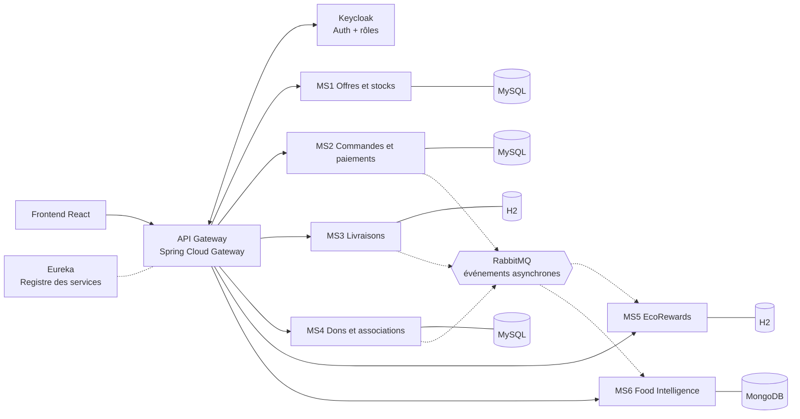

# ReFood : Moins de gaspillage, plus de solidarité

> Projet AWD : architecture microservices | Équipe **Five Core** | Classe : `4DASI9` 

ReFood est une application web qui connecte les **commerçants** ayant des surplus invendus avec des **clients** (vente de paniers à prix réduit), des **associations** (dons gratuits) et des **livreurs** (transport), afin de réduire le gaspillage alimentaire.

> ⚠️ **État du projet : validation intermédiaire (séance 4).** Le projet n'est pas finalisé. Ce dépôt présente la conception, l'organisation et les premières réalisations.

---


## 🎯 Problématique

Chaque jour, des produits encore consommables sont jetés par les commerces, alors que des consommateurs et des associations ont besoin de produits abordables ou de dons.

**Notre solution :** une seule application pour **vendre** des paniers à prix réduit, **donner** les surplus aux associations et **livrer** les commandes et les dons.

## 🧑‍🤝‍🧑 Acteurs et fonctionnalités

| Acteur | Fonctionnalités principales |
|---|---|
| **Commerçant** | Publier une offre, gérer les quantités, suivre ventes et dons |
| **Client** | Rechercher des offres, commander et payer, suivre sa commande |
| **Association** | Déclarer ses besoins, demander un don, suivre la réception |
| **Livreur** | Consulter et accepter des missions, confirmer la livraison |
| **Tous** | S'authentifier, gagner points et badges, consulter son historique |
| **Système (IA)** | Prédire les surplus, recommander des associations |

---

## 🏗️ Architecture



📄 Le diagramme complet se trouve dans [`Documentation/Diagrams/`](Documentation/Diagrams/).

### Microservices

| # | Service | Responsabilité | Base | Interactions |
|---|---|---|---|---|
| MS1 | **Offres et stocks** | Publier des offres payantes ou gratuites, gérer les quantités | MySQL | Appelé par MS2 et MS4 |
| MS2 | **Commandes et paiements** | Parcours d'achat, statuts de commande, paiement et remboursement | MySQL | Appelé par MS1 et MS3 |
| MS3 | **Livraisons** | Créer, affecter et suivre les livraisons | H2 | Appelé par MS2 et MS4 |
| MS4 | **Dons et associations** | Besoins des associations, attribution et suivi des dons | MySQL | Appelé par MS1 et MS3 |
| MS5 | **EcoRewards** | Points, badges, niveaux, défis, classement | H2 | Reçoit des événements (RabbitMQ) |
| MS6 | **Food Intelligence** *(commun)* | Analyse des historiques, prédiction des surplus, recommandation d'associations | MongoDB | Reçoit les historiques, conseille MS1 et MS4 |

### Communication

- **Synchrone** : REST avec OpenFeign, quand une réponse immédiate est nécessaire. Exemple : MS2 vérifie le stock auprès de MS1.
- **Asynchrone** : événements RabbitMQ, une fois l'action terminée. Exemple : don livré, MS5 attribue des points.

### Sécurité

- Authentification et autorisation via **Keycloak** (JWT).
- Le JWT est vérifié à l'**API Gateway**, qui route ensuite les requêtes vers les microservices.
- Rôles : `COMMERCANT`, `CLIENT`, `ASSOCIATION`, `LIVREUR`, `ADMIN`.

---

## 🛠️ Technologies

| Couche | Technologies |
|---|---|
| Frontend | React |
| Backend | Java, Spring Boot, Maven |
| Infrastructure | Spring Cloud Gateway, Eureka, OpenFeign |
| Sécurité | Keycloak, JWT |
| Messagerie | RabbitMQ |
| Bases de données | MySQL, H2, MongoDB |
| Déploiement | Docker |
| Gestion de projet | *(à compléter : Trello / Jira / GitHub Projects)* |

---


---

## 🔌 Contrats d'API (aperçu)

| Service | Endpoints principaux |
|---|---|
| MS1 | `POST /offers` · `GET /offers?type=&category=` · `PUT /offers/{id}` · `PATCH /offers/{id}/stock` |
| MS2 | `POST /orders` · `GET /orders/me` · `PATCH /orders/{id}/cancel` · `POST /payments` |
| MS3 | `POST /deliveries` · `PATCH /deliveries/{id}/assign` · `PATCH /deliveries/{id}/status` · `GET /deliveries/me` |
| MS4 | `POST /needs` · `GET /donations/available` · `POST /donations` · `PATCH /donations/{id}/accept` |
| MS5 | `GET /points/me` · `GET /badges` · `GET /leaderboard` · `POST /challenges` |
| MS6 | `GET /predictions/surplus` · `GET /recommendations/associations` · `POST /analysis/refresh` |

Les codes de réponse et les événements détaillés sont dans le dossier technique.

---

## 🚀 Lancer le projet

> 📝 À compléter au fur et à mesure de l'avancement.

### Prérequis

- Java 17+
- Maven
- Node.js 18+
- Docker et Docker Compose

### Démarrage

```bash
# 1. Cloner le dépôt
git clone https://github.com/<organisation>/refood-4das-gX.git
cd refood-4das-gX

# 2. Lancer l'infrastructure (Keycloak, RabbitMQ, bases de données)
docker compose up -d

# 3. Lancer les services backend (Eureka, Gateway, puis les microservices)
cd Backend/<service> && mvn spring-boot:run

# 4. Lancer le frontend
cd Frontend && npm install && npm start
```

---


## 🌍 Objectifs de développement durable

ODD 1 (Pas de pauvreté) · ODD 2 (Faim zéro) · ODD 11 (Villes durables) · ODD 12 (Consommation responsable) · ODD 13 (Lutte climatique)

---

## 📚 Documentation

- Présentation : [`Documentation/Presentation/`](Documentation/Presentation/)
- Diagrammes : [`Documentation/Diagrams/`](Documentation/Diagrams/)
- Dossier technique : [`Documentation/`](Documentation/)

*ReFood : Moins de gaspillage, plus de solidarité* 🌱
